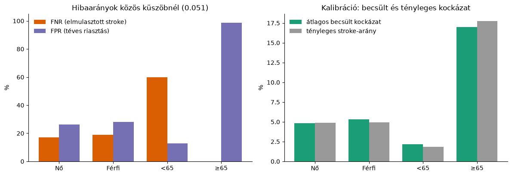

# Stroke-kockázati baseline-modell csoportonkénti vizsgálata

Egy egyszerű logisztikus regressziós stroke-modell vizsgálata: **eltér-e a modell teljesítménye és kockázatbecslése nőknél és férfiaknál, illetve a 65 év alatti és a legalább 65 éves csoportban?**

Az elemzés a [Stroke Prediction Dataset](https://www.kaggle.com/datasets/fedesoriano/stroke-prediction-dataset) (Kaggle, 5110 sor) adatain készült. Oktatási célú munka, a modell nem alkalmas klinikai döntéstámogatásra.

## Fő eredmények

A lezárt teszthalmazon (1022 sor, 50 stroke-eset) a modell AUC-ja 0,839. A tanítóadaton, keresztvalidációval rögzített közös küszöb (0,051) mellett a recall 82% (FNR 18,0%), az FPR 27,1%. Az átlagos becsült kockázat (5,0%) megegyezik a tényleges stroke-aránnyal (4,9%).

| Csoport | Stroke-esetek | FNR | FPR | Becsült kockázat | Tényleges arány |
|---|---|---|---|---|---|
| Nő | 29 | 17,2% | 26,2% | 4,8% | 4,9% |
| Férfi | 21 | 19,0% | 28,2% | 5,3% | 4,9% |
| <65 | 15 | 60,0% | 12,7% | 2,2% | 1,8% |
| ≥65 | 35 | 0,0% | 98,8% | 17,0% | 17,8% |

- **Nők és férfiak:** nem találtam érdemi eltérést sem a hibaarányokban, sem a kalibrációban. A kis esetszám miatt ez „nincs kimutatott eltérés", nem bizonyított egyenlőség.
- **Életkor szerint** a hibaarányok erősen eltérnek, a kalibráció viszont mindkét csoportban jó. A 65 év alattiaknál a modell a stroke-ok 60%-át elmulasztja, a 65 év felettieknél pedig gyakorlatilag mindenkit pozitívnak jelöl, így ott az FNR = 0% a küszöb következménye, nem a modell erőssége.
- A hibaarányok eltérését nem a rossz kalibráció okozza, hanem a **közös küszöb és a nagyon eltérő alaparány** (2,2% kontra 15,5% a teljes adathalmazon). Ez megfelel annak az elméleti eredménynek, hogy eltérő alaparányú csoportokban a kalibráció és az egyenlő hibaarányok általában nem teljesülhetnek egyszerre (Kleinberg, Mullainathan és Raghavan, 2016; Chouldechova, 2017).



## Módszer

1. Betöltés, a `gender = Other` egyetlen sor kiszűrése, korcsoport-változó (<65 / ≥65) képzése, ami csak csoportképző, bemenetként nem használt.
2. Feltáró elemzés a teljes adathalmazon, csak leíró célból.
3. 80/20 tanító/teszt szétválasztás (`stratify=stroke`, `random_state=42`), a teszthalmazt egyszer értékelem ki.
4. Logisztikus regresszió osztálysúlyozás nélkül (a súlyozás felfelé torzítaná a becsült valószínűségeket, ez ellehetetlenítené a kalibráció vizsgálatát). Medián-imputálás a BMI-re, standardizálás a numerikus, one-hot kódolás a kategorikus változókra.
5. Egyetlen, minden csoportra közös küszöb: a tanítóadaton, 5-szörös keresztvalidációval kapott valószínűségekből a legmagasabb küszöb, ahol a recall legalább 0,80.
6. Csoportonként: FNR, FPR, az átlagos becsült kockázat és a tényleges stroke-arány összevetése.

## Futtatás

```bash
python -m venv .venv
source .venv/bin/activate        # Windowson: .venv\Scripts\activate
pip install -r requirements.txt
jupyter notebook stroke_fairness_audit.ipynb
```

Az adat automatikusan letöltődik a `kagglehub`-bal. Ehhez internetkapcsolat, egyes környezetekben Kaggle-hitelesítés kell. Letöltés nélkül is futtatható, ha a `STROKE_CSV` környezeti változó a CSV elérési útjára mutat:

```bash
export STROKE_CSV=/utvonal/healthcare-dataset-stroke-data.csv      # Windows PowerShell: $env:STROKE_CSV="..."
```

## Korlátok

- Kevés stroke-eset a teszthalmazban, különösen a 65 év alattiaknál (15): az FNR ott néhány esetre épül. Konfidenciaintervallumot nem számoltam, ezért a csoportok közti különbségekről nem mondható ki, hogy statisztikailag megalapozottak. Az életkori különbség (9 kontra 0 elmulasztott eset) szinte biztosan nem véletlen.
- Az átlagos kalibráció nem teljes kalibráció: azt nem vizsgáltam, hogy a csoportokon belül a magasabb becsült kockázat a magasabb tényleges arányt jelzi-e (ehhez csoportonkénti AUC vagy kalibrációs görbe kellene).
- Egyetlen szétválasztás, más véletlen felosztással az értékek elmozdulhatnak.
- A küszöb egy előre választott célból (recall ≥ 0,80) származik, más célnál a hibaarányok is mások lennének.
- Az adathalmaz eredete ismeretlen, a modell keresztmetszeti adatból a meglévő stroke-státuszt becsüli, nem előrejelez klinikai értelemben.

## Szerkezet

```
.
├── stroke_fairness_audit.ipynb   # a teljes elemzés, futtatott kimenetekkel
├── figures/                      # a notebook ábrái PNG-ben
├── requirements.txt
└── README.md
```
